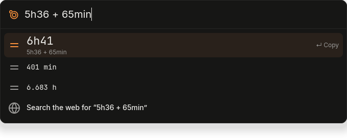
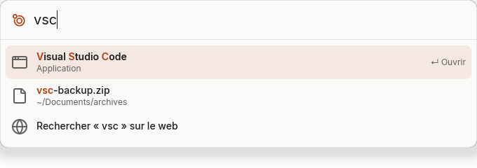

# Flair

Launcher clavier façon Spotlight / Raycast / PowerToys Run, en Rust, pour **Windows 10/11** et **Linux** (X11 et Wayland). Un raccourci global (`Alt+Espace`) fait apparaître une barre de recherche ; on tape, on choisit au clavier, `Entrée`.

| Sombre, interface en anglais | Calcul | Clair, interface en français |
|---|---|---|
|  |  |  |

> **État : jalon 8 (thèmes, Wayland et finitions) — tous les jalons du cahier des charges sont faits.** Flair est résident (icône de notification, raccourci global, instance unique, aucun réveil fenêtre cachée), s'installe lui-même, se met à jour par `> mise à jour` avec des versions signées publiées à chaque push sur `main`, et sauvegarde tout dans un fichier `.flair`. Il trouve et lance les **applications installées** (Windows et Linux, avec leurs icônes), classées par `nucleo-matcher` et par la frecency, et **calcule** en français et en anglais à la fois (nombres, fonctions, unités, octets, durées, heures, dates, fuseaux horaires, horodatages Unix, bases, opérations bit à bit, temps de transfert, devises), et **cherche les fichiers** dans un index compact ouvert depuis le disque, tenu à jour en direct. La recherche web passe par des mots-clés configurables, les commandes système (verrouiller, éteindre…) sont reconnues en français et en anglais avec confirmation, et **tout se règle depuis Flair** avec les commandes `>` (`> config`, `> langue`, `> help`). Le cahier des charges complet est dans [`PROMPT.md`](PROMPT.md).

## Applications

- **Windows** : raccourcis `.lnk` du menu Démarrer (le vôtre et celui de tous les utilisateurs), lus avec `IShellLinkW`, et applications du Store (`shell:AppsFolder`, lancées par leur AppUserModelID). Les noms sont ceux du menu Démarrer, dans la langue de Windows ; le nom du raccourci, l'exécutable cible (`explorer`) et une table d'alias anglais des applications intégrées (`Settings`, `File Explorer`, `Task Manager`, `Calculator`…) sont aussi recherchables. Les désinstalleurs et les raccourcis vers de la documentation sont ignorés. `Ctrl+Entrée` lance en administrateur. Icônes extraites par le shell (`IShellItemImageFactory`), en cache dans `%LocalAppData%\Flair\cache\icons`.
- **Linux** : fichiers `.desktop` de `$XDG_DATA_HOME`, `$XDG_DATA_DIRS`, Flatpak et Snap, en respectant `NoDisplay`, `Hidden`, `OnlyShowIn`/`NotShowIn` et `TryExec`. `Name`, `Name[fr]`, `GenericName` et `Keywords` dans les deux langues sont indexés : `Fichiers` et `Files` trouvent tous les deux le gestionnaire de fichiers. Codes de `Exec` (`%f`, `%U`, `%i`, `%c`, `%k`…) et `Terminal=true` gérés. Icônes du thème courant (`freedesktop-icons`), PNG et SVG.
- **Mise à jour à chaud** : les dossiers sources sont surveillés (`notify`) ; un changement relance l'indexation après 2 s de calme. « Réindexer » dans l'icône de notification force un nouveau parcours.
- **Classement** : `nucleo-matcher` (accents et casse ignorés), bonus si la requête est le début du nom, d'un mot ou des initiales (`vsc` → **V**isual **S**tudio **C**ode), applications avant fichiers à score égal, et **frecency** : chaque lancement est enregistré dans `frecency.json` (nombre et date du dernier usage, inclus dans les exports `.flair`), et ce qui est lancé souvent et récemment remonte. Les correspondances trop dispersées (`calc` dans « Lo**c**al Security Poli**c**y ») sont écartées.

## Fichiers

On tape une partie du nom (`rapport`, `facture 2025`, `ete mer` pour `été à la mer.jpg`) : les fichiers et dossiers de l'index s'affichent avec leur dossier en sous-titre (`~/Documents/Projets`). `Entrée` ouvre avec l'application par défaut, `Ctrl+Entrée` ouvre le dossier qui le contient avec le fichier sélectionné (Explorateur ; sous Linux, le gestionnaire de fichiers via `org.freedesktop.FileManager1`, sinon le dossier), `Ctrl+C` copie le chemin.

- **Recherche** : tous les mots tapés doivent être dans le nom, dans n'importe quel ordre, sans tenir compte de la casse ni des accents. Le nom exact passe en premier (avec ou sans extension : `rapport` → `rapport.pdf`), puis les noms qui commencent par la requête, puis ceux où elle commence un mot ; les dossiers avant les fichiers, les chemins courts avant les profonds, et la frecency fait remonter ce qu'on ouvre souvent. Mesuré : 2 à 6 ms sur 150 000 à 250 000 entrées (profil Windows réel, `/usr` + dossier personnel sous Linux), 12 à 19 ms sur un index synthétique d'un million d'entrées (moitié de noms accentués), sur 4 threads au-delà de 200 000 entrées.
- **Chemins** : `~/Doc`, `/etc/`, `C:\Us`, `D:` listent le dossier directement (pas l'index), dossiers d'abord, filtrés par le début du nom ; `Tab` complète (avec `/` ou `\` après un dossier, pour continuer dedans, et `~` gardé s'il a été tapé). Les fichiers cachés ne s'affichent que si on tape `.`.
- **Index compact** (`flair-providers/src/files/index.rs`) : tous les noms dans un seul tampon d'octets, chaque entrée en 12 octets (parent, début et longueur du nom, drapeaux), jamais un `String` ou un `PathBuf` par fichier ; les chemins sont reconstruits pour les seuls résultats affichés. Sauvegardé avec `rkyv` dans `index/files-<date>.idx` (dossier des données) et **ouvert par `memmap2`, sans copie** : le système ne charge que les pages lues par une recherche, et la validation `rkyv` à chaque ouverture coûte quelques microsecondes. Environ 27 octets par entrée sur disque (4,9 Mo pour 146 000 fichiers). Chaque scan écrit un nouveau fichier et supprime l'ancien : un fichier mappé ne peut pas être remplacé sous Windows.
- **Démarrage** : l'index sauvegardé sert immédiatement, puis un scan complet rattrape en arrière-plan ce qui a changé pendant que Flair ne tournait pas.
- **Scan** : parcours parallèle maison (la moitié des cœurs), qui construit directement l'index compact, chaque thread en **priorité arrière-plan** pour le CPU et le disque (`THREAD_MODE_BACKGROUND_BEGIN` sous Windows ; `nice 19` et `ioprio` classe *idle* sous Linux). Mesuré : 146 000 entrées en 0,6 s (profil Windows), 246 000 en 1 s (Linux). Les liens symboliques sont indexés mais jamais suivis ; les noms qui ne sont pas de l'Unicode valide sont ignorés.
- **Exclusions** : `files.exclude` (par défaut `node_modules`, `.git`, `target`, `.cache`, `__pycache__`) accepte un nom (`node_modules`, `*.tmp`), une fin de chemin (`build/out`) ou un chemin absolu (`/proc`), avec `*`, sans tenir compte de la casse. S'y ajoutent les dossiers bruyants : `AppData\Local`, `AppData\LocalLow`, `AppData\Roaming\*\Cache`, `$Recycle.Bin`, `System Volume Information` sous Windows ; `/proc`, `/sys`, `/dev`, `/run`, `/tmp`, `~/.local/share/Trash` sous Linux ; les caches de navigateur (`cache2`, `GPUCache`, `Code Cache`). Fichiers cachés exclus par défaut (`files.include_hidden`), et sous Windows ceux qui ont l'attribut caché ou système.
- **Racines** : `files.roots` (par défaut `["~"]`, qui contient Bureau, Documents, Téléchargements et Images) ; `files.other_drives = true` ajoute les autres disques fixes sous Windows (`D:\`, `E:\`…). Une racine contenue dans une autre n'est parcourue qu'une fois.
- **Mise à jour en direct** : `notify` avec `notify-debouncer-full` (événements regroupés après 1,5 s de calme, sans le cache d'identifiants de fichiers qui reparcourrait tout l'arbre sous Windows). Les changements vont dans un petit index en mémoire (entrées supprimées, chemins ajoutés, nouveaux dossiers parcourus avec leur contenu) ; au-delà de 20 000 changements ou de 5 000 chemins d'un coup, un nouveau scan réécrit l'index. Mesuré : 200 fichiers écrits d'un coup = 2 réveils. Sous Windows, une surveillance récursive par racine. Sous Linux, inotify demande une surveillance par dossier : seuls les dossiers indexés sont surveillés (pas les `node_modules` exclus), dans la limite de la moitié de `fs.inotify.max_user_watches` ; au-delà, un message dans les logs, et les dossiers non surveillés sont rescannés quand la fenêtre s'affiche, au plus tous les quarts d'heure (pas de minuterie fenêtre cachée).
- **Mode batterie** (`resources.pause_on_battery`, activé par défaut) : sur batterie, les changements sont mis de côté et les scans reportés ; tout est rattrapé à l'affichage suivant sur secteur. La recherche marche avec l'index existant. « Réindexer » (icône de notification) force un scan même sur batterie. L'état de l'alimentation est lu quand quelque chose arrive (changement de fichier, affichage), jamais en boucle.
- **Icônes** : celles du système, par type de fichier (icône shell sous Windows, icône du type MIME dans le thème sous Linux, d'après `shared-mime-info`), chargées en arrière-plan et gardées en cache ; l'icône intégrée de Flair s'affiche en attendant, la vraie à la frappe suivante.
- **Statistiques** (`flair --stats`) : taille de l'index (fichier / mémoire hors fichier), nombre d'entrées, dossiers surveillés ; les rafales de changements de fichiers comptent dans les réveils.

## Calculatrice

On tape un calcul, en français, en anglais ou en mélangeant les deux : `15% de 240`, `5 km to miles`, `1 Gio en Mo`, `une heure en minutes`, `10 kW fois 3h`, `pgcd(12; 18)`, `sin(30)`, `1/3 + 1/6`. Le résultat principal s'affiche en grand, les variantes dessous : fraction et décimale, nombre complet d'une notation scientifique, octets décimaux et binaires (`Mo` et `Mio`), autres lectures d'une saisie ambiguë (« lu comme : 5 min »). `Entrée` copie le résultat affiché, `Ctrl+Entrée` le calcul complet (`1/3 + 1/6 = 1/2`), `Alt+Entrée` la valeur brute (sans unité, avec un point décimal).

- **Pipeline** (`flair-providers/src/calc/`) : détection rapide, découpage en jetons, mots reconnus avec les **fichiers de langue** et leurs conditions, toutes les lectures possibles (16 au plus) évaluées par [`fend-core`](https://github.com/printfn/fend), celles qui échouent écartées : l'évaluation tranche les ambiguïtés. Mise en forme dans la langue de l'interface (`1,5` et `jours` en français).
- **Fichiers de langue** : [`lexicon/`](lexicon/README.md) (`common.toml`, `fr.toml`, `en.toml`), intégrés au binaire. Ajouter une langue = ajouter un fichier. On peut ajouter ou remplacer des fichiers dans le dossier `lexicon/` de la configuration (relus quand la configuration est rechargée ; un fichier invalide est ignoré, la raison est dans les logs). Désactiver une langue dans `input_languages` désactive vraiment ses mots : avec `["fr"]` seul, `5 km to miles` n'est plus un calcul.
- **Nombres** : séparateurs de milliers (`1 500`, `1'000'000`, `1_000`, `1,000,000`, espaces insécables), virgule décimale selon `decimal_separator` (en `auto`, `1,500` suit la langue du système et l'autre lecture est proposée en variante), notation scientifique au-delà de 15 chiffres, `significant_digits` chiffres significatifs pour les valeurs approchées.
- **Durées et heures** : `5h36 + 65min` = `6h41` (variantes `6:41`, `401 min`, `6.683 h`), `1h45 * 3`, `3h45 en min`, `2.5 h en h:min` = `2h30`, `10000 s en h:min:s` = `2h46m40s`, `2:45:10`. Heures de la journée : `14:30 + 2h45` = `17h15`, `23h + 3h` = `2h (lendemain)`. En anglais : `6h 41m`, `2:00 (next day)`.
- **Dates** (évaluateur dédié, `jiff`) : `26/11/2026 + 45 jours` = `10 janvier 2027 (dimanche)`, différences (`25/12/2026 - 26/11/2026` = `29 jours`), `jours jusqu'au 25 décembre`, `semaines depuis le 1er janvier`, `quel jour 14 juillet 1789`, `maintenant + 3h` (ou `3h + maintenant`), `dans 90 min`, `il y a 2h`, `3 jours plus tard`, `demain + 1 semaine`, `demain à 14h`, `dans 3 jours à 14h`, `lundi prochain`, `vendredi dernier`, `de 9h à 17h30` = `8h30`, et leurs équivalents anglais (`days until December 25`, `2h ago`, `3 days from now`, `tomorrow at 3pm`, `next Monday`, `from 9am to 5pm`…). Compter dans une unité : `années depuis 1999` = `27 ans`, `âge 14/07/1990`, `mois depuis janvier 2020`, `heures jusqu'à 18h`, `secondes jusqu'à minuit`, `temps jusqu'à 18h`, `jusqu'à vendredi`. Fêtes sans année : `jours jusqu'à noël`, `quel jour pâques`, nouvel an, Saint-Valentin, Halloween… Seuls : `maintenant`, `demain`, `quel jour sommes-nous`. `jj/mm/aaaa` ou `mm/jj/aaaa` selon `date_format` (en `auto`, la convention de la langue), ISO `aaaa-mm-jj` toujours. Le résultat affiche le mois en lettres et le jour de la semaine ; les formes numériques et ISO sont en variantes. L'heure courante est injectée (trait `Clock`) : les tests sont déterministes.
- **Unix et fuseaux** : `@1700000000` = `14/11/2023 22:13:20 UTC` (heure locale en variante), `maintenant en unix`, `unix 1700000000`, `heure à Tokyo` / `time in Tokyo`, `heure au Japon`, `now in UTC`, `heure à Tokyo en Paris` / `now Tokyo to Paris` (avec `Tokyo 22h12 → Paris 14h12` en variante), `15h Tokyo en Paris`, `3pm Tokyo` (vers l'heure locale), `9am PST to Paris`, `midi Tokyo en Paris`. Abréviations (`PST`, `EST`, `CET`, `JST`…) et pays d'un seul fuseau (`Japon`, `Chine`, `Inde`, `UK`…). Les villes sont cherchées dans la base des fuseaux (système sous Linux, intégrée au binaire sous Windows) ; les noms français qui diffèrent (`Londres`, `Pékin`, `Moscou`…) sont dans `fr.toml`.
- **Transferts** : `4 Go à 100 Mbit/s` = `5 min 20 s`, `1.5 To à 250 Mo/s` = `1h40` (`a` sans accent accepté entre une quantité et un débit).
- **Bases et bit à bit** : `0xff & 0x0f`, `5 xor 3`, `6 | 3`, `1 << 4`, `not 5` / `~5` (complément à deux), `42 en base 36` ; le résultat est affiché en décimal avec ses formes hexadécimale, binaire et octale en variantes.
- **Devises** (`currency = true` dans la config, désactivé par défaut) : `100 € en $`, `50 usd en eur`, `20 livres sterling en francs suisses`. Taux de la BCE via [Frankfurter](https://www.frankfurter.app) (gratuit, sans clé), récupérés en arrière-plan au démarrage, mis en cache (`rates.json` dans le dossier de cache) et rafraîchis au plus toutes les 6 heures ; hors ligne, le cache sert. La date des taux s'affiche en variante. Seule requête réseau de la calculatrice, sans aucune information sur l'utilisateur.
- **Historique** : chaque calcul copié est enregistré (`history.json`, `calc.history_size` entrées, inclus dans les exports `.flair`) ; `=` seul les affiche, recalculés.
- **Pendant la frappe** : une saisie qui ne calcule pas encore (`5h36 +`) garde le dernier résultat valide, en grisé.
- **Surfaces et volumes** : `1 ha en m²`, `100 m2 en pieds carrés`, `20 mètres carrés`, `2 cm3 en ml`, `square feet`, `cubic meters` ; résultat affiché `m²`. Aussi `5'11" en cm`, `1m80 en pieds`, `100 c to f`.
- **Formulations** : `combien font 2 + 2`, `what is 15% of 80`, `la moitié de 50`, `le double de 21`, `un tiers de 90`, `est-ce que 17 est premier`, `is 17 prime` ; fonctions `max`, `min`, `moyenne`/`avg`, `somme`/`sum` (`max(1 km, 900 m)` compare avec les unités) ; `10 % 3` est un modulo ; `0xff` ou `1e3` seuls sont convertis en décimal.
- **Erreurs** : `1/0` affiche « Division par zéro impossible » (« Cannot divide by zero »), `log(0)` ou `tan(90)` « Non défini ».
- **Robustesse** : 50 ms au plus pour toutes les lectures d'une saisie ; au-delà (`10^10^10^10`, `1000000!`), « Trop grand pour être calculé ». Évaluation hors du thread de l'interface, annulée à chaque frappe.
- **Ce que Flair ajoute à fend-core** (vérifié avant de coder) : les unités `kbit`/`Mbit`/`Gbit` et `Kibit`/`Mibit`, `Mbps`, les octets français (`Ko`, `Mo`, `Go`, `Kio`…, `Mo` étant le mois pour fend) ; `gcd`/`pgcd`, `lcm`/`ppcm`, test de primalité (Miller-Rabin) et forme fonction de `nCr(n; k)`/`nPr` ; l'ajout et le retrait de pourcentages (`240 + 15%` = 276, fend donne 240,15) ; le regroupement des quantités (`100 km / 1.5h`, que fend lit `(100 km / 1.5) × h`) ; `5 ft 11 in` et `5 pieds 11` additionnés ; les degrés par défaut en trigonométrie (`angle_unit`) ; `kWh` pour une puissance multipliée par une durée (fend répond en joules) ; `x` et `·` pour multiplier ; les préfixes `0x`/`0b`/`0o` des conversions de base ; l'arrondi aux chiffres significatifs et la notation scientifique en sortie.
- **Tests** : `lexicon/tests/{common,fr,en}.toml`, environ 400 cas exécutés avec chaque combinaison de langues (`fr`, `en`, `fr`+`en`, `en`+`fr`) et dans les deux langues d'interface ; chaque cas français a son jumeau anglais au même résultat ; tests de propriétés (`proptest`) : aucune saisie ne fait paniquer le moteur.

## Installer

Télécharger `flair-windows-x86_64.exe` (ou `flair-linux-x86_64`) depuis la [page des versions](https://github.com/TomuCard/Flair/releases) et le lancer. Au premier lancement, Flair propose :
- **Installer Flair** : copie dans `%LocalAppData%\Programs\Flair\flair.exe` (sans droits administrateur), raccourci dans le menu Démarrer, lancement au démarrage (coché par défaut), entrée dans « Applications installées », association des fichiers `.flair`. Sous Linux : `~/.local/bin/flair`, entrée `.desktop`, icône, type MIME ;
- **Utiliser sans installer** : mode portable, Flair reste où il est (les mises à jour marchent si le dossier est accessible en écriture).

**Avertissement SmartScreen** : l'exe n'est pas encore signé avec un certificat Authenticode. Au **premier** lancement d'un exe téléchargé avec un navigateur, Windows affiche « Windows a protégé votre ordinateur » : cliquer sur « Informations complémentaires » puis « Exécuter quand même ». Les mises à jour téléchargées par Flair lui-même ne déclenchent pas cet avertissement.

**Désinstaller** : `> désinstaller` / `> uninstall`, ou depuis Paramètres → Applications installées. Flair demande s'il faut garder la configuration et les données.

## Compiler et lancer

Prérequis : Rust stable (édition 2024), installé avec [rustup](https://rustup.rs).

### Linux (et WSL2)

```bash
cargo build                 # debug
cargo build --release       # optimisé (LTO fat, binaire strippé)
cargo run -p flair-app -- --show
```

Dépendances d'exécution sous Linux (déjà présentes sur un bureau) : `libxkbcommon` (+ `libxkbcommon-x11` sous X11), un serveur D-Bus de session pour l'icône de notification. Aucune bibliothèque système n'est nécessaire pour compiler.

**Sous WSL2 (WSLg)** :
- WSLg est une session Wayland : le raccourci global n'y existe pas. Utiliser `flair --toggle` (ou `--show`) depuis un terminal ;
- WSLg n'expose pas de pilote Vulkan matériel : `renderer = "gpu"` (wgpu) y reste bloqué à la création de la surface. Le rendu logiciel (choix par défaut, voir « Moteur de rendu ») fonctionne ;
- si la fenêtre ne s'ouvre pas (« NoCompositor »), lancer avec `XDG_RUNTIME_DIR=/mnt/wslg/runtime-dir`.

### Windows, compilé depuis WSL

```bash
cargo install cargo-xwin
rustup target add x86_64-pc-windows-msvc
cargo xwin build --release --target x86_64-pc-windows-msvc -p flair-app
# → target/x86_64-pc-windows-msvc/release/flair.exe
```

Puis lancer le `.exe` depuis WSL ou après l'avoir copié sous `C:\`. La CRT est liée statiquement (`.cargo/config.toml`) : aucun Visual C++ Redistributable n'est nécessaire. En release, aucune console ne s'ouvre (`windows_subsystem = "windows"`).

### Windows, compilé nativement

```powershell
cargo build --release -p flair-app
```

## Utilisation

Flair tourne en permanence en arrière-plan ; la fenêtre est cachée et réaffichée, jamais relancée.

| Commande | Effet |
|---|---|
| `flair` | Lance Flair et affiche la fenêtre ; si Flair tourne déjà, affiche sa fenêtre |
| `flair --background` | Lance Flair sans afficher la fenêtre (utilisé par « Lancer au démarrage ») |
| `flair --toggle` | Affiche ou cache la fenêtre de l'instance lancée (à lier à un raccourci du bureau sous Wayland) |
| `flair --show` | Affiche la fenêtre |
| `flair --stats` | Statistiques de l'instance lancée (mémoire, réveils, temps du dernier affichage, moteur de rendu…) |
| `flair --quit` | Ferme l'instance lancée |
| `flair --update` | Cherche une mise à jour et l'installe |
| `flair --export <fichier> [--settings-only]` | Exporte tout (ou les réglages seulement) dans un `.flair` |
| `flair --import <fichier> [--merge]` | Importe un `.flair` (sauvegarde automatique avant) ; `--merge` : thèmes et lexiques seulement |
| `flair <fichier>.flair` | Ouvre Flair sur le résumé d'import (double-clic sur un export) |
| `flair --uninstall` | Affiche l'écran de désinstallation |
| `flair --version` | Version, commit, date de compilation et canal |

### Commandes `>`

Tout ce qui se règle dans `config.toml` se règle aussi depuis Flair. `>` seul affiche les commandes les plus utiles et `> help` / `> aide` en dernier ; `> help` les liste **toutes** par catégorie (Réglages, Apparence, Langues, Recherche et fichiers, Web, Calcul, Système, Flair), avec une description et un exemple ; `> help fich` filtre ; `Entrée` sur une commande affiche sa syntaxe, `Tab` l'écrit dans le champ. L'aide est générée depuis le catalogue des commandes, les fichiers de langue et le registre des réglages (un test vérifie que chaque commande a un titre, une description et un exemple dans les deux langues, et des mots dans chaque langue).

**Mots des commandes** : dans les fichiers de langue (`[commands]`, `[arguments]` de `lexicon/fr.toml`, `en.toml`), ils suivent donc les langues actives : avec le français désactivé, `> verrouiller` n'est plus reconnu, `> lock` l'est. `> help` / `> aide`, `> config` et `> langue` / `> language` sont aussi dans `common.toml` et marchent toujours (on peut toujours réactiver une langue). Accents et casse ignorés ; la forme la plus longue l'emporte (`> redémarrer flair` avant `> redémarrer`). **Autocomplétion** : `> con`, `> config the`, `> config theme.mode ` proposent les commandes, les réglages puis les valeurs ; `Tab` complète.

| Commande (FR / EN) | Effet |
|---|---|
| `> config` / `> réglages` / `> settings` | Tous les réglages avec leur valeur, leur défaut s'il diffère et les valeurs permises ; filtre flou sur la clé, le nom et les alias des deux langues (`> config transp` → `theme.opacity`). `Entrée` bascule un booléen, liste les choix d'une liste de valeurs, ou écrit `> config <réglage> <valeur actuelle>` prêt à modifier |
| `> config <réglage> <valeur>` | `> config max_results 10`, `> config transparence 0.9`, `> config calc.angle_unit rad` ; `défaut` / `reset` remet la valeur par défaut ; listes : `ajouter` / `add`, `retirer` / `remove` |
| `> config ouvrir` / `open`, `> config recharger` / `reload` | Ouvre le fichier dans l'éditeur par défaut, le relit |
| `> annuler` / `> undo` | Annule le dernier changement de réglage fait par commande, sinon le dernier import |
| `> transparence 0.9`, `> raccourci Ctrl+Espace`, `> démarrage on`, `> résultats 10`, `> icônes mono`, `> rendu cpu` | Raccourcis vers un réglage (`opacity`, `hotkey`, `autostart`, `results`, `icons`, `renderer`) |
| `> fichiers` / `> files` | `ajouter D:\Projets`, `exclure .venv`, `cachés on`, `retirer …` ; seul : les réglages des fichiers |
| `> web` | Liste les moteurs (`Entrée` : chercher avec) ; `> web ajouter yt YouTube https://www.youtube.com/results?search_query={query}` ; `> web retirer yt` |
| `> calcul` / `> calc` | `angle rad`, `chiffres 15`, `devises on`, `octets binaire` |
| `> batterie pause on` / `> battery pause off` | Pause de l'indexation sur batterie |
| `> langue` / `> language` | Langues de saisie avec leur état et leur ordre (`Entrée` active ou désactive), et la langue de l'interface ; `> langue fr désactiver`, `> language en prefer`, `> langue interface en`. Désactiver la dernière langue active est refusé |
| `> verrouiller` / `> lock`, `> veille` / `> sleep`, `> éteindre` / `> shutdown`, `> redémarrer` / `> restart`, `> se déconnecter` / `> log out`, `> vider la corbeille` / `> empty trash` | Commandes système (aussi trouvées sans `>` : taper `verrouiller` suffit). Éteindre, redémarrer, se déconnecter et vider la corbeille demandent un **second `Entrée`** |
| `> réindexer` / `> reindex` | Reparcourt les applications et les fichiers |
| `> historique effacer` / `> history clear` | Efface l'historique des calculs et la frecency (second `Entrée`) |
| `> statistiques` / `> stats`, `> journaux` / `> logs` | Statistiques ; ouvre le dossier des journaux |
| `> mise à jour` / `> update` (+ `annuler` / `rollback`, `canal stable`) | Mise à jour, retour à la version précédente, canal |
| `> exporter` / `> export`, `> importer` / `> import` | Fichier `.flair` (voir plus bas) |
| `> redémarrer flair` / `> restart flair` | Relance Flair (proposé après un réglage appliqué au démarrage : `log_level`, `resources.renderer`) |
| `> version`, `> installer` / `> install` (mode portable), `> désinstaller` / `> uninstall`, `> quitter` / `> quit` | |

**Règles communes** :
- **Validation avant écriture**, avec les règles du fichier : une valeur invalide affiche la raison dans la ligne (« doit être entre 1 et 20 ») et rien n'est écrit.
- **Écriture avec `toml_edit`**, commentaires et mise en forme gardés, puis application immédiate. Les moteurs web sont réécrits en blocs `[[web]]`.
- **Aperçu en direct** des réglages d'apparence (`theme.opacity`, `theme.mode`, `theme.light`, `theme.dark`) : la ligne sélectionnée s'applique pendant qu'on navigue ; `Entrée` la garde, `Échap` ou une autre saisie revient en arrière.
- **Raccourci global** : le nouveau est enregistré d'abord ; refusé (déjà pris, Wayland), l'ancien reste et la raison s'affiche.
- **Lancement au démarrage** : l'entrée du système (registre `Run`, fichier `autostart`) est changée en même temps que le réglage.

**Recherche web** : chaque moteur de `[[web]]` a un mot-clé (par défaut `g` Google, `ddg` DuckDuckGo, `wiki` Wikipédia, `yt` YouTube : `g rust iced`, `yt lofi`) ; `?` cherche avec tous les moteurs (`? rust` ; `?yt lofi` avec un seul) ; sans préfixe, « Rechercher « … » sur le web » (premier moteur de la liste) est toujours proposé en dernier. La requête est encodée en UTF-8 (`été & co` → `%C3%A9t%C3%A9+%26+co`).

**Commandes système** : Windows : `LockWorkStation`, `SetSuspendState`, `ExitWindowsEx` (avec le privilège d'arrêt activé pour éteindre et redémarrer), `SHEmptyRecycleBinW`. Linux : `loginctl lock-session` / `terminate-session`, `systemctl suspend` / `poweroff` / `reboot` (logind, autorisé à l'utilisateur de la session locale active par les règles polkit par défaut), corbeille vidée selon la spécification freedesktop (`~/.local/share/Trash`). Pas de `zbus` ni de crate `trash` : les outils de systemd parlent déjà à logind, et vider la corbeille du dossier personnel tient en quelques lignes.

Une seule instance tourne à la fois : un second `flair` envoie sa commande à l'instance existante (named pipe sous Windows, socket Unix abstraite sous Linux, crate `interprocess`) puis quitte.

**Raccourci global** (`hotkey`, `Alt+Space` par défaut) :
- Windows : `global-hotkey` (`RegisterHotKey`) ;
- X11 : implémentation propre avec `x11rb` (`XGrabKey` sur la fenêtre racine, thread bloqué sur la connexion X). La crate `global-hotkey` n'est **pas** utilisée sous X11 : sa boucle interroge le serveur X toutes les 50 ms, soit 20 réveils par seconde en permanence ;
- Wayland : portail XDG GlobalShortcuts (`zbus`) quand le bureau le fournit ; sinon, au premier lancement, Flair explique comment lier un raccourci du bureau à `flair --toggle`.

Si le raccourci est déjà pris par une autre application, Flair démarre quand même et l'explique dans sa fenêtre (`Entrée` ouvre la configuration).

**Icône de notification** : Afficher, Réindexer (applications et fichiers), Ouvrir la configuration, Rechercher une mise à jour (jalon 3), Lancer au démarrage, Statistiques, Quitter. Un clic gauche affiche ou cache la fenêtre. L'icône est le logo rendu à l'exécution (`resvg`) dans la couleur de la barre des tâches (`SystemUsesLightTheme` sous Windows).
- Windows : `tray-icon` ;
- Linux : StatusNotifierItem via `ksni` sur un runtime Tokio d'un seul thread. Le backend KSNI de `tray-icon` impose la pile `async-io`, dont le pool `blocking` garde un thread qui se réveille toutes les 500 ms pour toujours : rejeté pour la même raison que ci-dessus. Sous GNOME, l'icône demande l'extension « AppIndicator ».

## Mises à jour

Chaque push sur `main` dont les tests passent publie une pré-version `X.Y.Z-main.N` (canal `main`) ; un tag `vX.Y.Z` publie une version stable (canal `stable`). Le workflow `.github/workflows/release.yml` :
1. relance fmt, clippy et les tests sur Windows et Linux (**s'ils échouent, rien n'est publié**) ;
2. compile nativement sur `windows-latest` et `ubuntu-latest`, avec la version, le commit et la date intégrés (`flair --version`) ;
3. signe chaque binaire (minisign, avec `rsign2`) avec le secret `FLAIR_SIGNING_KEY`, puis vérifie la signature avec la clé publique intégrée au code ;
4. écrit `manifest.json` (version, notes générées depuis les commits, `min_updater_version`, `config_version`, `requires_reset`, SHA-256 de chaque binaire) ;
5. vérifie que **la version publiée précédente sait lire le nouveau manifest** (`--check-manifest`) ;
6. publie la release GitHub et ne garde que les 20 dernières pré-versions `main`.

**Sécurité** :
- signature Ed25519 (minisign) **et** SHA-256 vérifiés **avant** de toucher à quoi que ce soit ; la clé publique est dans le binaire, la clé privée seulement dans le secret GitHub ;
- le commentaire signé contient la version et la plateforme : un ancien binaire signé ne peut pas être présenté comme une nouvelle version ;
- HTTPS uniquement (rustls) ; le dépôt (`TomuCard/Flair`) est fixé à la compilation, la configuration ne peut pas rediriger les mises à jour ;
- jamais de retour à une version plus ancienne, sauf `> mise à jour annuler`.

**Déroulement** : téléchargement avec progression, vérification, `flair.exe` renommé en `flair.previous.exe` (un exe en cours d'exécution peut être renommé) et remplacé par la nouvelle version, puis redémarrage. Une sauvegarde `.flair` est faite avant. La nouvelle version confirme son démarrage une fois la fenêtre prête : si elle plante **deux fois de suite** avant, le lancement suivant restaure automatiquement la version précédente et l'annonce.

**Vérification automatique** (`update.auto_check`) : au plus une fois toutes les 24 h, **seulement quand on ouvre Flair**, jamais par un minuteur. Une version disponible est signalée par une ligne dans la liste `>`. Rien n'est jamais installé sans demande.

**Gros changements** : les migrations de configuration (`config_version`, une étape testée par version, sauvegarde `.flair` avant) évitent toute réinstallation. `requires_reset = true` dans le manifest prévient avant, sauvegarde, puis réinitialise. Si la version installée est plus ancienne que `min_updater_version`, Flair renvoie vers la page des versions (seul cas de retéléchargement).

**Mises à jour désactivées** pour les compilations locales (`X.Y.Z-dev`), les installations par un gestionnaire de paquets (`/usr`) et un dossier non accessible en écriture.

## Exporter et importer : fichiers `.flair`

Un `.flair` est une archive ZIP de fichiers texte : `manifest.json`, `config.toml`, `themes/*.toml`, `lexicon/*.toml`, `data/history.json`, `data/frecency.json`. Jamais l'index, le cache d'icônes, les logs ni du code. Les chemins du dossier personnel sont écrits `~` pour rester valables sur un autre PC (Windows ↔ Linux).

Un `.flair` n'est pas fiable par défaut : seuls les chemins attendus sont lus, un chemin absolu ou avec `..` fait refuser toute l'archive, la taille est limitée (10 Mo par fichier, 50 Mo au total une fois décompressé), chaque fichier est validé comme s'il était écrit à la main, et **rien n'est écrit avant que toute l'archive soit lue et vérifiée**. Un fichier d'une version plus récente est refusé ; un fichier plus ancien passe par les migrations.

Sauvegardes automatiques (avant une mise à jour, un import, une migration ou une réinitialisation) : même format, dans `backups/` du dossier de données, 10 conservées.

## Thèmes

Un thème, c'est 3 couleurs (fond, texte, accent) ; toutes les autres couleurs en sont dérivées avec des contrastes garantis (voir « Organisation »). Deux thèmes intégrés, **Flair clair** et **Flair sombre** ; les autres sont des fichiers `themes/*.toml` du dossier de configuration (`%AppData%\Flair\themes\`, `~/.config/flair/themes/`) :

```toml
name = "Lavande"
background = "#1E1B2E"
foreground = "#E6E1F5"
accent = "#B79CFF"      # facultatif : sans accent, les lettres trouvées sont seulement en semi-gras
```

- **`> thème` / `> theme`** liste les thèmes ; **naviguer applique le thème en aperçu**, `Entrée` le garde, `Échap` revient en arrière. Un thème va dans l'emplacement clair ou sombre (`theme.light` / `theme.dark`) selon son fond ; si le mode est forcé sur l'autre type, il bascule.
- **`> thème 1E1B2E E6E1F5 B79CFF lavande`** crée un thème à partir de 3 couleurs (fond, texte, accent ; `#` facultatif, `#RGB` accepté) et l'affiche aussitôt en aperçu, avec « contraste ajusté » si des couleurs ont dû être corrigées (`> thème 777777 888888 808080` reste lisible). `Entrée` enregistre `themes/lavande.toml` et l'applique. Sans nom : `perso-1`, `perso-2`…
- **Mode `system`** (par défaut) : Flair suit le thème clair ou sombre du système **en direct**, sans redémarrage. Windows : valeur `AppsUseLightTheme`, surveillée par `RegNotifyChangeKeyValue` (thread bloqué jusqu'au changement). Linux : portail XDG Settings (`org.freedesktop.appearance` / `color-scheme`, signal `SettingChanged`, par `zbus` déjà présent pour l'icône de notification), avec `gsettings` en secours au démarrage. L'icône de notification change de couleur avec.
- Un fichier de thème invalide est ignoré avec un message (`> ` affiche la raison quand le champ est vide) ; il ne casse jamais le thème actif.

## Rechargement à chaud

Le dossier de configuration est surveillé (`notify`) : modifier `config.toml`, un thème ou un fichier de langue s'applique en quelques centaines de millisecondes, sans redémarrage. Une rafale d'écritures donne un seul rechargement ; le thread dort jusqu'au changement. Une erreur de syntaxe garde la dernière configuration valide et affiche l'erreur.

## Moteur de rendu

`resources.renderer = "auto" | "gpu" | "cpu"`. **`auto` choisit le rendu logiciel** (`tiny-skia`), d'après les mesures :

| Mesure (fenêtre cachée) | GPU (`wgpu`, Direct3D / Vulkan) | Logiciel (`tiny-skia`) |
|---|---|---|
| Windows 11, mémoire | 243 Mo | 31 Mo |
| WSLg, mémoire | — (bloqué, pas de GPU utilisable) | 24 Mo |

Pour une barre de 680 px de large, le rendu logiciel est largement assez rapide et n'occupe ni contexte GPU ni mémoire vidéo. `renderer = "gpu"` reste disponible (`appliqué au prochain démarrage`).

## Sobriété : mesures

Mesuré sous WSLg (Wayland et X11 via XWayland, rendu logiciel), build release :

| Mesure | Résultat | Objectif |
|---|---|---|
| Affichage de la fenêtre (raccourci → première image) | X11 : 2,6 à 4,4 ms (fenêtre gardée chaude) ; Wayland : 12 à 15 ms (fenêtre recréée) | < 50 ms |
| Premier affichage au lancement (démarrage du processus compris) | 17 à 20 ms | — |
| RAM fenêtre cachée, sans index | 24 Mo | < 40 Mo |
| Réveils en 30 s fenêtre cachée (compteur interne) | 0, index de fichiers et surveillance actifs | 0 |
| 200 fichiers écrits d'un coup dans un dossier surveillé | 2 réveils | une poignée |
| Changements de contexte en 30 s, tous threads confondus | 0 | 0 |
| Temps CPU consommé en 30 s fenêtre cachée | 0 | 0 |

Le compteur de réveils (`flair --stats`) compte chaque événement traité : fenêtre, clavier, souris, raccourci, menu, IPC. Interroger `--stats` ne compte pas comme un réveil.

**Mémoire rendue quand Flair est caché** : `resources.trim_memory_after` secondes après le masquage (5 par défaut, 0 = jamais), un seul réveil différé (annulé si Flair réapparaît avant) vide les caches temporaires (images des icônes envoyées au moteur de rendu, derniers résultats), puis :
- Windows : **mode efficacité** (EcoQoS, `SetProcessInformation` / `ProcessPowerThrottling`, si `resources.efficiency_mode`) et `EmptyWorkingSet` : les pages passent dans la liste d'attente du système, libres pour les autres programmes et relues depuis la RAM (pas le disque) au prochain affichage. Le mode efficacité est coupé dès que la fenêtre s'affiche ;
- Linux : `malloc_trim(0)` (glibc) rend au système la mémoire libérée.

L'index de fichiers est déjà hors du tas (fichier mappé) : le système reprend ses pages tout seul.

**Benchmarks** (`cargo bench -p flair-providers`, `criterion`) : mesurés sous WSL2, build release :

| Opération | Temps | Objectif |
|---|---|---|
| Calcul : `15% de 240`, `26/11/2026 + 45 jours`, `heure à Tokyo en Paris` | 6 à 18 µs | < 16 ms |
| Calcul avec unités ou fonctions : `5 km en miles`, `5h36 + 65min`, `sin(pi/6) + sqrt(2)` | 0,14 à 0,19 ms | < 16 ms |
| Saisie qui n'est pas un calcul (`firefox`) | 0,6 µs | — |
| Classement de 500 applications (`vsc`) | 6 µs | < 16 ms |
| Fichiers : recherche dans un index d'un million d'entrées (moitié de noms accentués) | 11 à 19 ms | < 50 ms |

**Vérifier soi-même** :
- Linux : `pidstat -w -t -p $(pgrep -x flair) 5` (aucun `cswch/s` quand Flair est caché), `powertop` (Flair absent de la liste des réveils), et `flair --stats` à une heure d'écart ;
- Windows : Process Explorer, propriétés de `flair.exe`, onglet *Threads* : la colonne « Context Switch Delta » doit rester à 0 fenêtre cachée ; onglet *Performance* : « Private Bytes ».

## Qualité

```bash
cargo fmt --all
cargo clippy --workspace --all-targets -- -D warnings
cargo test --workspace
```

La CI (GitHub Actions, `.github/workflows/ci.yml`) lance `fmt`, `clippy`, `test`, la compilation des benchmarks et `flair lexicon check` sur `ubuntu-latest` et `windows-latest` ; `release.yml` publie une version signée à chaque push sur `main` dont les tests passent.

## Organisation

```
crates/
├── flair-core/       types, trait Provider, registre des réglages, config, thèmes, i18n (sans UI)
├── flair-providers/  sources de résultats : applications, calculatrice, fichiers (web, système à venir)
├── flair-platform/   code propre à l'OS : chemins, raccourci global, icône de notification, IPC,
│                     démarrage auto, mémoire, écran sous la souris (seul crate avec `unsafe`)
└── flair-app/        binaire `flair` : interface Iced, logs, lancement
lexicon/              fichiers de langue de la calculatrice et leurs tests
assets/
├── fonts/            Inter et JetBrains Mono (OFL)
├── icons/            logo Flair (flair.svg, flair-tiny.svg)
└── ui-icons/         icônes Lucide (ISC)
```

- **Registre des réglages** (`flair-core/src/settings/registry.rs`) : chaque réglage est décrit une seule fois (type, bornes, noms, descriptions et alias FR/EN). Le fichier `config.toml` par défaut, la validation et la table ci-dessous en sont générés. Un test vérifie que chaque champ de la config a son entrée, et inversement.
- **Thèmes** (`flair-core/src/theme/`) : 3 couleurs → jetons, avec mélanges en Oklab, ajustements en OKLCH et contrastes WCAG 2 garantis. Un test de propriétés vérifie les minimums de contraste sur des milliers de thèmes aléatoires.
- **Traductions** : `flair-core/i18n/{fr,en}.ftl` (Fluent). Un test vérifie que les deux fichiers ont les mêmes messages.
- **Dimensions** : toutes dans `flair-app/src/design.rs` (grille de 4 px).

## Configuration

Fichier créé au premier lancement, avec des commentaires, dans la langue du système :

| | Windows | Linux |
|---|---|---|
| config | `%AppData%\Flair\config.toml` | `~/.config/flair/config.toml` |
| données, logs | `%LocalAppData%\Flair\` | `~/.local/share/flair/` |
| cache | `%LocalAppData%\Flair\cache\` | `~/.cache/flair/` |

Une erreur dans le fichier n'empêche jamais le démarrage. La valeur fautive est remplacée par sa valeur par défaut, et l'erreur s'affiche dans la fenêtre quand le champ est vide.

Logs : un fichier par jour dans `logs/` du dossier de données (7 conservés). Le niveau se règle avec `log_level` ou la variable `FLAIR_LOG` (prioritaire, syntaxe `tracing`, par exemple `FLAIR_LOG=debug`).

Réglages (table générée depuis le registre, `UPDATE_README=1 cargo test -p flair-core --test readme` pour la mettre à jour) :

<!-- settings:start -->
| Clé | Défaut | Description |
|---|---|---|
| `hotkey` | `"Alt+Space"` | Raccourci qui affiche ou cache Flair |
| `ui_language` | `"system"` | Langue de l'interface et des résultats (system \| fr \| en) |
| `input_languages` | `["fr", "en"]` | Langues de saisie actives, dans l'ordre de préférence (> langue / > language) |
| `decimal_separator` | `"auto"` | Virgule ou point pour les nombres décimaux (auto \| , \| .) |
| `date_format` | `"auto"` | Ordre jour, mois, année des dates numériques (auto \| dmy \| mdy \| ymd) |
| `max_results` | `8` | Nombre maximal de résultats affichés (1 à 20) |
| `keep_last_query` | `false` | Garder la dernière recherche quand Flair réapparaît |
| `autostart` | `false` | Lancer Flair à l'ouverture de la session |
| `log_level` | `"info"` | Détail des journaux (FLAIR_LOG est prioritaire) (error \| warn \| info \| debug \| trace) |
| `calc.angle_unit` | `"deg"` | Unité par défaut des fonctions trigonométriques (deg \| rad) |
| `calc.significant_digits` | `10` | Chiffres significatifs affichés (1 à 100) |
| `calc.binary_prefixes` | `false` | Ko/Mo/Go en 1024 (comme l'Explorateur Windows) au lieu de 1000 |
| `calc.currency` | `false` | Conversions de devises (taux téléchargés et mis en cache) |
| `calc.history_size` | `50` | Nombre de calculs gardés dans l'historique (0 à 1000) |
| `theme.mode` | `"system"` | Suivre le système, ou forcer le thème clair ou sombre (system \| light \| dark) |
| `theme.light` | `"Flair clair"` | Thème utilisé en mode clair |
| `theme.dark` | `"Flair sombre"` | Thème utilisé en mode sombre |
| `theme.opacity` | `1.0` | Transparence du fond, si la plateforme le permet (0.85 à 1) |
| `theme.icons` | `"color"` | Icônes d'applications en couleur ou monochromes (color \| mono) |
| `theme.font` | `"inter"` | inter, system, ou le nom d'une police installée |
| `theme.tray_icon` | `"auto"` | Couleur de l'icône : suit la barre des tâches, ou couleur d'accent (auto \| accent) |
| `files.enabled` | `true` | Indexer et rechercher les fichiers |
| `files.roots` | `["~"]` | Dossiers racines de l'index de fichiers |
| `files.exclude` | `["node_modules", ".git", "target", ".cache", "__pycache__"]` | Noms de dossiers ou motifs ignorés par l'index |
| `files.include_hidden` | `false` | Indexer aussi les fichiers et dossiers cachés |
| `files.other_drives` | `false` | Windows : indexer aussi les autres disques (D:\, E:\…) |
| `resources.renderer` | `"auto"` | Rendu GPU, ou logiciel (cpu) sans mémoire vidéo (auto \| gpu \| cpu) |
| `resources.pause_on_battery` | `true` | Suspendre la surveillance et l'indexation sur batterie |
| `resources.trim_memory_after` | `5` | Secondes après le masquage avant de libérer la mémoire (0 = jamais) (0 à 3600) |
| `resources.efficiency_mode` | `true` | Windows : mode efficacité (EcoQoS) quand Flair est caché |
| `providers.apps` | `true` | Rechercher les applications installées |
| `providers.calculator` | `true` | Calculs et conversions |
| `providers.web` | `true` | Mots-clés de recherche web |
| `providers.system` | `true` | Verrouiller, éteindre, redémarrer… |
| `update.channel` | `"main"` | main : chaque push sur main ; stable : versions taguées (main \| stable) |
| `update.auto_check` | `true` | Vérifier au plus une fois par jour, à l'ouverture de Flair |
| `web` | `g, ddg, wiki, yt` | Mots-clés et adresses des moteurs de recherche ({query} = la recherche) |
<!-- settings:end -->

## Limitations connues

- **Position** : sous Windows, la fenêtre apparaît sur l'écran sous la souris. Sous Linux, elle reste sur l'écran principal (X11 : à faire ; Wayland : impossible sans layer-shell).
- **layer-shell (Wayland)** : non fait. Iced 0.14 crée ses fenêtres avec winit, qui ne gère pas le protocole `wlr-layer-shell` ; il faudrait remplacer la boucle d'Iced par [`iced_layershell`](https://github.com/waycrate/exwlshelleventloop) sous Wayland, un autre runtime à maintenir en parallèle. Proposition : le faire quand Iced l'intégrera, ou comme une option expérimentale ensuite. En attendant, sous Wayland la fenêtre est une fenêtre normale (barre des tâches, position choisie par le compositeur).
- **Raccourci global sous Wayland** : par le portail XDG GlobalShortcuts quand le bureau le fournit (GNOME 48+, KDE Plasma 5.27+, Hyprland…) ; le bureau peut demander une confirmation et laisser choisir une autre touche. Sans portail (WSLg, anciens bureaux), Flair explique comment lier un raccourci du bureau à `flair --toggle`. Le portail n'a pas pu être essayé ici (WSLg n'en a pas) : à vérifier sur un vrai bureau.
- **Commandes `>`** : les valeurs des listes de choix (`dark`, `rad`…) s'écrivent telles quelles, sans traduction.
- **Progression de mise à jour** : affichée dans la fenêtre ; pas encore dans l'infobulle de l'icône de notification.
- **Icônes Linux** : seule l'icône vectorielle (`hicolor/scalable`) est installée, pas encore les PNG 16 à 256 px.
- **Wayland, masquage** : winit ne sait pas cacher une fenêtre sous Wayland. Flair la ferme et en ouvre une nouvelle à l'affichage suivant (12 à 15 ms mesurés). Sans portail XDG (WSLg), le premier affichage attend 100 ms un portail qui ne répond pas (`sctk_adwaita`, imposé par Iced).
- **Fenêtre Linux** : elle apparaît dans la barre des tâches sous Linux (Iced n'expose pas cet attribut ; voir layer-shell).
- **Wayland, hauteur de la fenêtre** : winit applique un redimensionnement demandé par l'application sans envoyer d'événement `Resized`, et Iced ne refait alors pas sa mise en page. Sous Wayland, la fenêtre transparente garde donc sa hauteur maximale et seul le cadre visible change de taille. Sous Windows et X11, la fenêtre est redimensionnée normalement.
- **Ombre** : seulement celle du système (DWM sous Windows, avec les coins arrondis). Flair ne dessine pas d'ombre lui-même : le rendu logiciel d'Iced ne redessine que le contour d'un rectangle, pas son ombre, qui se repeignait sur elle-même jusqu'à devenir noire.
- **Curseur du champ** : Iced 0.14 dessine le curseur avec la couleur du texte. La spec le veut en couleur d'accent, ce qui demande un petit widget dédié (à faire).
- **Premier affichage après le démarrage** : les applications sont indexées en arrière-plan (environ 1 à 2 s sous Windows, icônes comprises). Une recherche tapée avant la fin ne les trouve pas encore ; une recherche déjà affichée ne se met pas à jour quand une icône arrive.
- **Nouvelles applications du Store** : les raccourcis sont surveillés, pas le dossier `shell:AppsFolder`. Une application du Store installée pendant que Flair tourne apparaît après « Réindexer » ou au prochain démarrage.
- **Calculatrice** : pas de cryptomonnaies (`1 btc en €`) ; les heures de la journée sont reconnues dans un calcul (`23h + 3h`), pas seules ; un `14h30` sans opération reste une durée. Les dates sans année (`25 décembre`, `noël`) prennent la prochaine occurrence, et la dernière avec « depuis ». Un mois seul (`Mars 2020`) n'est pas lu comme une date, sauf après « depuis », « jusqu'à » ou « quel jour ». `1 an en jours` donne l'année moyenne de fend (365,24 jours).
- **Icônes Linux** : les icônes XPM (anciennes applications) ne sont pas lues ; l'icône générique les remplace.
- **Fichiers** : pas encore de lecture de la MFT / du journal USN NTFS (indexation façon *Everything*) ; l'architecture le permet (un autre producteur pour le même index). Sous Linux, `other_drives` ne fait rien : les disques montés sont des dossiers de l'arbre, à ajouter dans `files.roots`. La recherche porte sur le nom, pas sur le chemin complet (`projets rapport` ne trouve pas `Projets/rapport.md`). Une icône de type qui arrive ne met pas à jour la liste déjà affichée.

## Développement

Tests d'intégration qui demandent un vrai serveur X (raccourci global simulé par XTEST) :

```bash
cargo test -p flair-platform --test x11_hotkey -- --ignored
cargo run -p flair-platform --example x11_press -- alt space   # simule Alt+Espace
```

Options cachées utiles pour vérifier l'interface sans clavier :

```bash
flair --show --dev-query "vsc" --dev-screenshot capture.png
```

Elles tapent la requête, enregistrent une capture PNG de la fenêtre, puis quittent (les captures du haut de cette page sont faites ainsi).

Conflits entre fichiers de langue (même forme, sens différents) : la commande les liste avec un exemple de saisie, et échoue s'il en reste un non résolu. La CI la lance.

```bash
flair lexicon check                 # toutes les combinaisons de langues
flair lexicon check --langs fr,en   # une seule (fichiers de l'utilisateur compris)
```

## Licences des ressources

- Inter, JetBrains Mono : SIL Open Font License 1.1 (`assets/fonts/*-LICENSE.txt`).
- Icônes Lucide : ISC (`assets/ui-icons/LICENSE.txt`).
