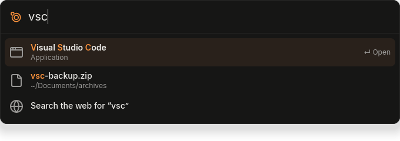

# Flair

Launcher clavier façon Spotlight / Raycast / PowerToys Run, en Rust, pour **Windows 10/11** et **Linux** (X11 et Wayland). Un raccourci global (`Alt+Espace`) fait apparaître une barre de recherche ; on tape, on choisit au clavier, `Entrée`.

| Sombre, interface en anglais | Calcul | Clair, interface en français |
|---|---|---|
|  |  |  |

> **État : jalon 3 (distribution et mises à jour).** Flair est résident (icône de notification, raccourci global, instance unique, aucun réveil fenêtre cachée), s'installe lui-même, se met à jour par `> mise à jour` avec des versions signées publiées à chaque push sur `main`, et sauvegarde tout dans un fichier `.flair`. Les résultats de recherche sont encore **factices** : les vraies sources (applications, calcul, fichiers, web, système) arrivent aux jalons 4 à 7. Le cahier des charges complet est dans [`PROMPT.md`](PROMPT.md).

## Installer

Télécharger `flair-windows-x86_64.exe` (ou `flair-linux-x86_64`) depuis la [page des versions](https://github.com/TomuCard/Flair/releases) et le lancer. Au premier lancement, Flair propose :
- **Installer Flair** : copie dans `%LocalAppData%\Programs\Flair\flair.exe` (sans droits administrateur), raccourci dans le menu Démarrer, lancement au démarrage (coché par défaut), entrée dans « Applications installées », association des fichiers `.flair`. Sous Linux : `~/.local/bin/flair`, entrée `.desktop`, icône, type MIME ;
- **Utiliser sans installer** : mode portable, Flair reste où il est (les mises à jour marchent si le dossier est accessible en écriture).

**Avertissement SmartScreen** : l'exe n'est pas encore signé avec un certificat Authenticode. Au **premier** lancement d'un exe téléchargé avec un navigateur, Windows affiche « Windows a protégé votre ordinateur » : cliquer sur « Informations complémentaires » puis « Exécuter quand même ». Les mises à jour téléchargées par Flair lui-même ne déclenchent pas cet avertissement.

**Désinstaller** : `> désinstaller` / `> uninstall`, ou depuis Paramètres → Applications installées. Flair demande s'il faut garder la configuration et les données.

## Compiler et lancer

Prérequis : Rust stable (édition 2024), installé avec [rustup](https://rustup.rs).

### Linux (et WSL2)

```bash
cargo build                 # debug
cargo build --release       # optimisé (LTO fat, binaire strippé)
cargo run -p flair-app -- --show
```

Dépendances d'exécution sous Linux (déjà présentes sur un bureau) : `libxkbcommon` (+ `libxkbcommon-x11` sous X11), un serveur D-Bus de session pour l'icône de notification. Aucune bibliothèque système n'est nécessaire pour compiler.

**Sous WSL2 (WSLg)** :
- WSLg est une session Wayland : le raccourci global n'y existe pas. Utiliser `flair --toggle` (ou `--show`) depuis un terminal ;
- WSLg n'expose pas de pilote Vulkan matériel : `renderer = "gpu"` (wgpu) y reste bloqué à la création de la surface. Le rendu logiciel (choix par défaut, voir « Moteur de rendu ») fonctionne ;
- si la fenêtre ne s'ouvre pas (« NoCompositor »), lancer avec `XDG_RUNTIME_DIR=/mnt/wslg/runtime-dir`.

### Windows, compilé depuis WSL

```bash
cargo install cargo-xwin
rustup target add x86_64-pc-windows-msvc
cargo xwin build --release --target x86_64-pc-windows-msvc -p flair-app
# → target/x86_64-pc-windows-msvc/release/flair.exe
```

Puis lancer le `.exe` depuis WSL ou après l'avoir copié sous `C:\`. La CRT est liée statiquement (`.cargo/config.toml`) : aucun Visual C++ Redistributable n'est nécessaire. En release, aucune console ne s'ouvre (`windows_subsystem = "windows"`).

### Windows, compilé nativement

```powershell
cargo build --release -p flair-app
```

## Utilisation

Flair tourne en permanence en arrière-plan ; la fenêtre est cachée et réaffichée, jamais relancée.

| Commande | Effet |
|---|---|
| `flair` | Lance Flair et affiche la fenêtre ; si Flair tourne déjà, affiche sa fenêtre |
| `flair --background` | Lance Flair sans afficher la fenêtre (utilisé par « Lancer au démarrage ») |
| `flair --toggle` | Affiche ou cache la fenêtre de l'instance lancée (à lier à un raccourci du bureau sous Wayland) |
| `flair --show` | Affiche la fenêtre |
| `flair --stats` | Statistiques de l'instance lancée (mémoire, réveils, temps du dernier affichage, moteur de rendu…) |
| `flair --quit` | Ferme l'instance lancée |
| `flair --update` | Cherche une mise à jour et l'installe |
| `flair --export <fichier> [--settings-only]` | Exporte tout (ou les réglages seulement) dans un `.flair` |
| `flair --import <fichier> [--merge]` | Importe un `.flair` (sauvegarde automatique avant) ; `--merge` : thèmes et lexiques seulement |
| `flair <fichier>.flair` | Ouvre Flair sur le résumé d'import (double-clic sur un export) |
| `flair --uninstall` | Affiche l'écran de désinstallation |
| `flair --version` | Version, commit, date de compilation et canal |

### Commandes `>` disponibles

| Commande (FR / EN) | Effet |
|---|---|
| `> mise à jour` / `> update` | Cherche la dernière version du canal ; `Entrée` l'installe |
| `> mise à jour annuler` / `> update rollback` | Revient à la version précédente (conservée sur le disque) |
| `> mise à jour canal stable` / `> update channel main` | Change de canal |
| `> version` | Version, commit, date et canal |
| `> exporter` / `> export` | « Tout » ou « Réglages seulement », puis boîte « Enregistrer sous » |
| `> importer` / `> import` | « Choisir un fichier… » ou une sauvegarde automatique, résumé, puis « Tout remplacer » ou « Ajouter les thèmes et lexiques » |
| `> annuler` / `> undo` | Revient à l'état d'avant le dernier import |
| `> installer` / `> install` | En mode portable : installer Flair |
| `> désinstaller` / `> uninstall` | Désinstaller |
| `> quitter` / `> quit` | Fermer Flair |

Le système de commandes complet (`> config`, `> help`, mots dans les fichiers de langue) arrive au jalon 7.

Une seule instance tourne à la fois : un second `flair` envoie sa commande à l'instance existante (named pipe sous Windows, socket Unix abstraite sous Linux, crate `interprocess`) puis quitte.

**Raccourci global** (`hotkey`, `Alt+Space` par défaut) :
- Windows : `global-hotkey` (`RegisterHotKey`) ;
- X11 : implémentation propre avec `x11rb` (`XGrabKey` sur la fenêtre racine, thread bloqué sur la connexion X). La crate `global-hotkey` n'est **pas** utilisée sous X11 : sa boucle interroge le serveur X toutes les 50 ms, soit 20 réveils par seconde en permanence ;
- Wayland : impossible sans le portail GlobalShortcuts (jalon 8). Au premier lancement, Flair explique comment lier un raccourci du bureau à `flair --toggle`.

Si le raccourci est déjà pris par une autre application, Flair démarre quand même et l'explique dans sa fenêtre (`Entrée` ouvre la configuration).

**Icône de notification** : Afficher, Réindexer (jalon 6), Ouvrir la configuration, Rechercher une mise à jour (jalon 3), Lancer au démarrage, Statistiques, Quitter. Un clic gauche affiche ou cache la fenêtre. L'icône est le logo rendu à l'exécution (`resvg`) dans la couleur de la barre des tâches (`SystemUsesLightTheme` sous Windows).
- Windows : `tray-icon` ;
- Linux : StatusNotifierItem via `ksni` sur un runtime Tokio d'un seul thread. Le backend KSNI de `tray-icon` impose la pile `async-io`, dont le pool `blocking` garde un thread qui se réveille toutes les 500 ms pour toujours : rejeté pour la même raison que ci-dessus. Sous GNOME, l'icône demande l'extension « AppIndicator ».

## Mises à jour

Chaque push sur `main` dont les tests passent publie une pré-version `X.Y.Z-main.N` (canal `main`) ; un tag `vX.Y.Z` publie une version stable (canal `stable`). Le workflow `.github/workflows/release.yml` :
1. relance fmt, clippy et les tests sur Windows et Linux (**s'ils échouent, rien n'est publié**) ;
2. compile nativement sur `windows-latest` et `ubuntu-latest`, avec la version, le commit et la date intégrés (`flair --version`) ;
3. signe chaque binaire (minisign, avec `rsign2`) avec le secret `FLAIR_SIGNING_KEY`, puis vérifie la signature avec la clé publique intégrée au code ;
4. écrit `manifest.json` (version, notes générées depuis les commits, `min_updater_version`, `config_version`, `requires_reset`, SHA-256 de chaque binaire) ;
5. vérifie que **la version publiée précédente sait lire le nouveau manifest** (`--check-manifest`) ;
6. publie la release GitHub et ne garde que les 20 dernières pré-versions `main`.

**Sécurité** :
- signature Ed25519 (minisign) **et** SHA-256 vérifiés **avant** de toucher à quoi que ce soit ; la clé publique est dans le binaire, la clé privée seulement dans le secret GitHub ;
- le commentaire signé contient la version et la plateforme : un ancien binaire signé ne peut pas être présenté comme une nouvelle version ;
- HTTPS uniquement (rustls) ; le dépôt (`TomuCard/Flair`) est fixé à la compilation, la configuration ne peut pas rediriger les mises à jour ;
- jamais de retour à une version plus ancienne, sauf `> mise à jour annuler`.

**Déroulement** : téléchargement avec progression, vérification, `flair.exe` renommé en `flair.previous.exe` (un exe en cours d'exécution peut être renommé) et remplacé par la nouvelle version, puis redémarrage. Une sauvegarde `.flair` est faite avant. La nouvelle version confirme son démarrage une fois la fenêtre prête : si elle plante **deux fois de suite** avant, le lancement suivant restaure automatiquement la version précédente et l'annonce.

**Vérification automatique** (`update.auto_check`) : au plus une fois toutes les 24 h, **seulement quand on ouvre Flair**, jamais par un minuteur. Une version disponible est signalée par une ligne dans la liste `>`. Rien n'est jamais installé sans demande.

**Gros changements** : les migrations de configuration (`config_version`, une étape testée par version, sauvegarde `.flair` avant) évitent toute réinstallation. `requires_reset = true` dans le manifest prévient avant, sauvegarde, puis réinitialise. Si la version installée est plus ancienne que `min_updater_version`, Flair renvoie vers la page des versions (seul cas de retéléchargement).

**Mises à jour désactivées** pour les compilations locales (`X.Y.Z-dev`), les installations par un gestionnaire de paquets (`/usr`) et un dossier non accessible en écriture.

## Exporter et importer : fichiers `.flair`

Un `.flair` est une archive ZIP de fichiers texte : `manifest.json`, `config.toml`, `themes/*.toml`, `lexicon/*.toml`, `data/history.json`, `data/frecency.json`. Jamais l'index, le cache d'icônes, les logs ni du code. Les chemins du dossier personnel sont écrits `~` pour rester valables sur un autre PC (Windows ↔ Linux).

Un `.flair` n'est pas fiable par défaut : seuls les chemins attendus sont lus, un chemin absolu ou avec `..` fait refuser toute l'archive, la taille est limitée (10 Mo par fichier, 50 Mo au total une fois décompressé), chaque fichier est validé comme s'il était écrit à la main, et **rien n'est écrit avant que toute l'archive soit lue et vérifiée**. Un fichier d'une version plus récente est refusé ; un fichier plus ancien passe par les migrations.

Sauvegardes automatiques (avant une mise à jour, un import, une migration ou une réinitialisation) : même format, dans `backups/` du dossier de données, 10 conservées.

## Moteur de rendu

`resources.renderer = "auto" | "gpu" | "cpu"`. **`auto` choisit le rendu logiciel** (`tiny-skia`), d'après les mesures :

| Mesure (fenêtre cachée) | GPU (`wgpu`, Direct3D / Vulkan) | Logiciel (`tiny-skia`) |
|---|---|---|
| Windows 11, mémoire | 243 Mo | 31 Mo |
| WSLg, mémoire | — (bloqué, pas de GPU utilisable) | 24 Mo |

Pour une barre de 680 px de large, le rendu logiciel est largement assez rapide et n'occupe ni contexte GPU ni mémoire vidéo. `renderer = "gpu"` reste disponible (`appliqué au prochain démarrage`).

## Sobriété : mesures

Mesuré sous WSLg (Wayland et X11 via XWayland, rendu logiciel), build release :

| Mesure | Résultat | Objectif |
|---|---|---|
| Affichage de la fenêtre (raccourci → première image) | X11 : 2,6 à 4,4 ms (fenêtre gardée chaude) ; Wayland : 12 à 15 ms (fenêtre recréée) | < 50 ms |
| Premier affichage au lancement (démarrage du processus compris) | 17 à 20 ms | — |
| RAM fenêtre cachée, sans index | 24 Mo | < 40 Mo |
| Réveils en 30 s fenêtre cachée (compteur interne) | 0 | 0 |
| Changements de contexte en 30 s, tous threads confondus | 0 | 0 |
| Temps CPU consommé en 30 s fenêtre cachée | 0 | 0 |

Le compteur de réveils (`flair --stats`) compte chaque événement traité : fenêtre, clavier, souris, raccourci, menu, IPC. Interroger `--stats` ne compte pas comme un réveil.

**Vérifier soi-même** :
- Linux : `pidstat -w -t -p $(pgrep -x flair) 5` (aucun `cswch/s` quand Flair est caché), `powertop` (Flair absent de la liste des réveils), et `flair --stats` à une heure d'écart ;
- Windows : Process Explorer, propriétés de `flair.exe`, onglet *Threads* : la colonne « Context Switch Delta » doit rester à 0 fenêtre cachée ; onglet *Performance* : « Private Bytes ».

## Qualité

```bash
cargo fmt --all
cargo clippy --workspace --all-targets -- -D warnings
cargo test --workspace
```

La CI (GitHub Actions, `.github/workflows/ci.yml`) lance `fmt`, `clippy` et `test` sur `ubuntu-latest` et `windows-latest`.

## Organisation

```
crates/
├── flair-core/       types, trait Provider, registre des réglages, config, thèmes, i18n (sans UI)
├── flair-providers/  sources de résultats (jalons 4 à 7)
├── flair-platform/   code propre à l'OS : chemins, raccourci global, icône de notification, IPC,
│                     démarrage auto, mémoire, écran sous la souris (seul crate avec `unsafe`)
└── flair-app/        binaire `flair` : interface Iced, logs, lancement
assets/
├── fonts/            Inter et JetBrains Mono (OFL)
├── icons/            logo Flair (flair.svg, flair-tiny.svg)
└── ui-icons/         icônes Lucide (ISC)
```

- **Registre des réglages** (`flair-core/src/settings/registry.rs`) : chaque réglage est décrit une seule fois (type, bornes, noms, descriptions et alias FR/EN). Le fichier `config.toml` par défaut, la validation et la table ci-dessous en sont générés. Un test vérifie que chaque champ de la config a son entrée, et inversement.
- **Thèmes** (`flair-core/src/theme/`) : 3 couleurs → jetons, avec mélanges en Oklab, ajustements en OKLCH et contrastes WCAG 2 garantis. Un test de propriétés vérifie les minimums de contraste sur des milliers de thèmes aléatoires.
- **Traductions** : `flair-core/i18n/{fr,en}.ftl` (Fluent). Un test vérifie que les deux fichiers ont les mêmes messages.
- **Dimensions** : toutes dans `flair-app/src/design.rs` (grille de 4 px).

## Configuration

Fichier créé au premier lancement, avec des commentaires, dans la langue du système :

| | Windows | Linux |
|---|---|---|
| config | `%AppData%\Flair\config.toml` | `~/.config/flair/config.toml` |
| données, logs | `%LocalAppData%\Flair\` | `~/.local/share/flair/` |
| cache | `%LocalAppData%\Flair\cache\` | `~/.cache/flair/` |

Une erreur dans le fichier n'empêche jamais le démarrage. La valeur fautive est remplacée par sa valeur par défaut, et l'erreur s'affiche dans la fenêtre quand le champ est vide.

Logs : un fichier par jour dans `logs/` du dossier de données (7 conservés). Le niveau se règle avec `log_level` ou la variable `FLAIR_LOG` (prioritaire, syntaxe `tracing`, par exemple `FLAIR_LOG=debug`).

Réglages (table générée depuis le registre, `UPDATE_README=1 cargo test -p flair-core --test readme` pour la mettre à jour) :

<!-- settings:start -->
| Clé | Défaut | Description |
|---|---|---|
| `hotkey` | `"Alt+Space"` | Raccourci qui affiche ou cache Flair |
| `ui_language` | `"system"` | Langue de l'interface et des résultats (system \| fr \| en) |
| `input_languages` | `["fr", "en"]` | Langues de saisie actives, dans l'ordre de préférence (> langue / > language) |
| `decimal_separator` | `"auto"` | Virgule ou point pour les nombres décimaux (auto \| , \| .) |
| `date_format` | `"auto"` | Ordre jour, mois, année des dates numériques (auto \| dmy \| mdy \| ymd) |
| `max_results` | `8` | Nombre maximal de résultats affichés (1 à 20) |
| `keep_last_query` | `false` | Garder la dernière recherche quand Flair réapparaît |
| `autostart` | `false` | Lancer Flair à l'ouverture de la session |
| `log_level` | `"info"` | Détail des journaux (FLAIR_LOG est prioritaire) (error \| warn \| info \| debug \| trace) |
| `calc.angle_unit` | `"deg"` | Unité par défaut des fonctions trigonométriques (deg \| rad) |
| `calc.significant_digits` | `10` | Chiffres significatifs affichés (1 à 100) |
| `calc.binary_prefixes` | `false` | Ko/Mo/Go en 1024 (comme l'Explorateur Windows) au lieu de 1000 |
| `calc.currency` | `false` | Conversions de devises (taux téléchargés et mis en cache) |
| `calc.history_size` | `50` | Nombre de calculs gardés dans l'historique (0 à 1000) |
| `theme.mode` | `"system"` | Suivre le système, ou forcer le thème clair ou sombre (system \| light \| dark) |
| `theme.light` | `"Flair clair"` | Thème utilisé en mode clair |
| `theme.dark` | `"Flair sombre"` | Thème utilisé en mode sombre |
| `theme.opacity` | `1.0` | Transparence du fond, si la plateforme le permet (0.85 à 1) |
| `theme.icons` | `"color"` | Icônes d'applications en couleur ou monochromes (color \| mono) |
| `theme.font` | `"inter"` | inter, system, ou le nom d'une police installée |
| `theme.tray_icon` | `"auto"` | Couleur de l'icône : suit la barre des tâches, ou couleur d'accent (auto \| accent) |
| `files.enabled` | `true` | Indexer et rechercher les fichiers |
| `files.roots` | `["~"]` | Dossiers racines de l'index de fichiers |
| `files.exclude` | `["node_modules", ".git", "target", ".cache", "__pycache__"]` | Noms de dossiers ou motifs ignorés par l'index |
| `files.include_hidden` | `false` | Indexer aussi les fichiers et dossiers cachés |
| `files.other_drives` | `false` | Windows : indexer aussi les autres disques (D:\, E:\…) |
| `resources.renderer` | `"auto"` | Rendu GPU, ou logiciel (cpu) sans mémoire vidéo (auto \| gpu \| cpu) |
| `resources.pause_on_battery` | `true` | Suspendre la surveillance et l'indexation sur batterie |
| `resources.trim_memory_after` | `5` | Secondes après le masquage avant de libérer la mémoire (0 = jamais) (0 à 3600) |
| `resources.efficiency_mode` | `true` | Windows : mode efficacité (EcoQoS) quand Flair est caché |
| `providers.apps` | `true` | Rechercher les applications installées |
| `providers.calculator` | `true` | Calculs et conversions |
| `providers.web` | `true` | Mots-clés de recherche web |
| `providers.system` | `true` | Verrouiller, éteindre, redémarrer… |
| `update.channel` | `"main"` | main : chaque push sur main ; stable : versions taguées (main \| stable) |
| `update.auto_check` | `true` | Vérifier au plus une fois par jour, à l'ouverture de Flair |
| `web` | `g, ddg, wiki, yt` | Mots-clés et adresses des moteurs de recherche ({query} = la recherche) |
<!-- settings:end -->

## Limitations connues

- **Position** : sous Windows, la fenêtre apparaît sur l'écran sous la souris. Sous Linux, elle reste sur l'écran principal (X11 : à faire ; Wayland : impossible sans layer-shell, jalon 8).
- **Mots des commandes `>`** : en attendant le jalon 7, les mots français et anglais des quelques commandes existantes sont dans le code (`commands.rs`), pas encore dans les fichiers de langue.
- **Progression de mise à jour** : affichée dans la fenêtre ; pas encore dans l'infobulle de l'icône de notification.
- **Icônes Linux** : seule l'icône vectorielle (`hicolor/scalable`) est installée, pas encore les PNG 16 à 256 px.
- **Wayland, masquage** : winit ne sait pas cacher une fenêtre sous Wayland. Flair la ferme et en ouvre une nouvelle à l'affichage suivant (12 à 15 ms mesurés). Sans portail XDG (WSLg), le premier affichage attend 100 ms un portail qui ne répond pas (`sctk_adwaita`, imposé par Iced).
- **Fenêtre Linux** : elle apparaît dans la barre des tâches sous Linux (Iced n'expose pas cet attribut) ; layer-shell (jalon 8) réglera ça sur KDE et wlroots.
- **Wayland, hauteur de la fenêtre** : winit applique un redimensionnement demandé par l'application sans envoyer d'événement `Resized`, et Iced ne refait alors pas sa mise en page. Sous Wayland, la fenêtre transparente garde donc sa hauteur maximale et seul le cadre visible change de taille. Sous Windows et X11, la fenêtre est redimensionnée normalement.
- **Ombre** : seulement celle du système (DWM sous Windows, avec les coins arrondis). Flair ne dessine pas d'ombre lui-même : le rendu logiciel d'Iced ne redessine que le contour d'un rectangle, pas son ombre, qui se repeignait sur elle-même jusqu'à devenir noire.
- **Curseur du champ** : Iced 0.14 dessine le curseur avec la couleur du texte. La spec le veut en couleur d'accent, ce qui demande un petit widget dédié (à faire).
- **Recherche factice** : la correspondance floue du jalon 1 est volontairement simple. `nucleo-matcher` et la frecency arrivent au jalon 4.

## Développement

Tests d'intégration qui demandent un vrai serveur X (raccourci global simulé par XTEST) :

```bash
cargo test -p flair-platform --test x11_hotkey -- --ignored
cargo run -p flair-platform --example x11_press -- alt space   # simule Alt+Espace
```

Options cachées utiles pour vérifier l'interface sans clavier :

```bash
flair --show --dev-query "vsc" --dev-screenshot capture.png
```

Elles tapent la requête, enregistrent une capture PNG de la fenêtre, puis quittent (les captures du haut de cette page sont faites ainsi).

## Licences des ressources

- Inter, JetBrains Mono : SIL Open Font License 1.1 (`assets/fonts/*-LICENSE.txt`).
- Icônes Lucide : ISC (`assets/ui-icons/LICENSE.txt`).
